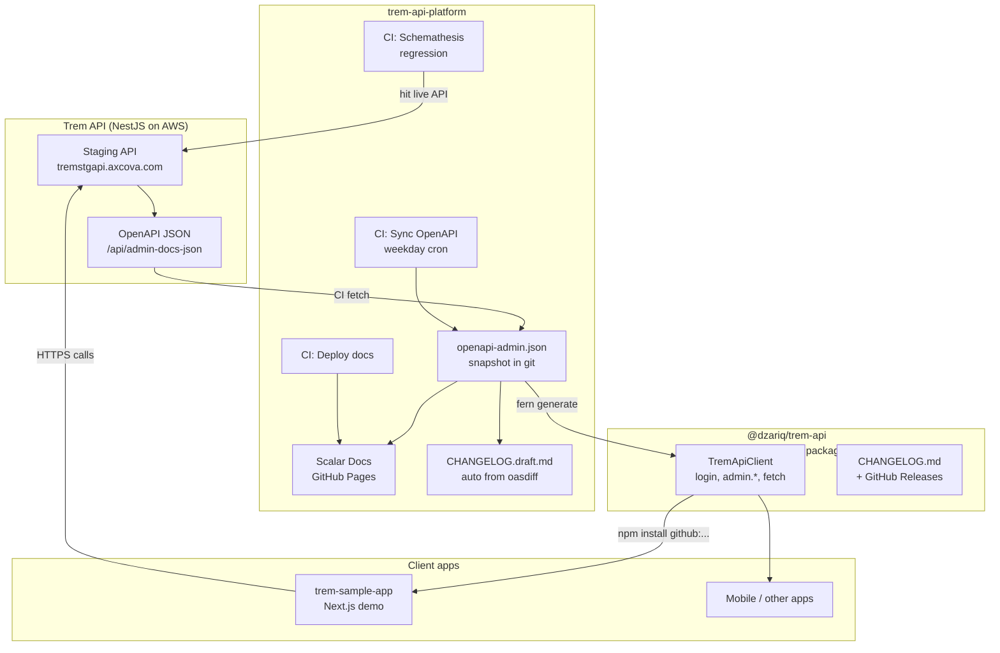

# Trem API + Fern SDK — Beginner Guide

Docs connector (Claude Docs) is not available in this session, so this guide lives in the repo as Markdown.

**Repos for:** understand what we built, how pieces connect, and what runs where.  
**You are:** API provider (Trem) who wants clients to use a typed SDK without hand-writing `fetch` everywhere.

---

## 1. Big picture (one sentence)

We turn the **Trem Admin API OpenAPI/Swagger** into a **TypeScript SDK** that apps install, plus **cloud automation** that keeps the OpenAPI snapshot, docs, and regression checks up to date.

---

## 2. Architecture (simple)



### What each box means

| Piece | Repo / place | Job |
|-------|----------------|-----|
| **Trem API** | Nest backend (existing) | Real business logic + Swagger |
| **trem-api-platform** | https://github.com/dzariq/trem-api-platform | Provider toolkit: OpenAPI sync, docs, tests, changelog draft |
| **@dzariq/trem-api** | https://github.com/dzariq/trem-api | Generated TypeScript SDK clients install |
| **trem-sample-app** | folder `trem/trem-sample-app` | Demo Next.js app using the SDK |

---

## 3. What we built (checklist)

### A. TypeScript SDK (for clients)

- Fern generated client from Admin OpenAPI
- Package name: `@dzariq/trem-api`
- Install: `npm install github:dzariq/trem-api#v0.1.0`
- Main usage:

```ts
import { TremApiClient } from "@dzariq/trem-api";

const client = new TremApiClient({
  baseUrl: "https://tremstgapi.axcova.com", // or destin/dev URL
  token: accessToken, // or auth: false for login
});

await client.admin.login({ email, password });
// Some endpoints use: await client.fetch(url)  // passthrough
```

- Changelog + GitHub Release notes: https://github.com/dzariq/trem-api/blob/main/CHANGELOG.md

### B. Sample app (proof it works)

- Folder: `trem-sample-app`
- Login with SDK → load shows list
- Shows which API it hits (`stg` vs custom) via `TREM_API_BASE_URL`

### C. Provider cloud toolkit (no need to run everything local)

Repo: **trem-api-platform** — GitHub Actions run in the cloud:

| Workflow | What it does | When |
|----------|--------------|------|
| **Sync OpenAPI** | Download latest swagger from stg → update git → draft changelog → open PR if changed | Weekday cron + manual button |
| **Regression** | Schemathesis: generate requests from OpenAPI, check responses match schema | Cron + PR + manual |
| **Docs Pages** | Publish Scalar API reference website | Push / manual |

**Docs site:** https://dzariq.github.io/trem-api-platform/  
- Admin: https://dzariq.github.io/trem-api-platform/admin/  
- Public: https://dzariq.github.io/trem-api-platform/public/

---

## 4. “Auto sync bila OpenAPI berubah” — plain English

1. Nest API team changes an endpoint → Swagger JSON on stg changes  
2. Cloud job (cron) downloads that JSON  
3. Compares to last saved file in git  
4. If different → updates files + writes a **draft changelog** + can open a **Pull Request**  
5. Human reviews → then regenerates SDK + releases new SDK version  

It does **not** auto-deploy the Nest API.  
It does **not** auto-publish a new SDK version without you (yet).  
It **does** keep the contract (OpenAPI) in git fresh.

---

## 5. Day-to-day flows

### Client developer (mobile / web)

```text
npm install github:dzariq/trem-api#v0.1.0
→ set baseUrl (stg / destin)
→ call client.admin.*
→ when SDK updates: bump tag to #v0.1.1 and read CHANGELOG
```

### API provider (you) when API changes

```text
1. Deploy API / change Nest controllers (Swagger updates on stg)
2. Cloud Sync OpenAPI runs (or click “Run workflow”)
3. Review PR + openapi/CHANGELOG.draft.md
4. fern generate --group local   (regenerate SDK)
5. Copy notes into sdks/typescript/CHANGELOG.md
6. ./scripts/release-sdk.sh 0.1.1
7. Tell clients to bump dependency tag
```

---

## 6. Folder map (on your laptop)

```text
trem/
├── trem-sample-app/          # Next.js demo using hosted SDK
└── fern-sdk/                 # = trem-api-platform git root
    ├── openapi-admin.json    # current Admin OpenAPI snapshot
    ├── openapi/
    │   ├── CHANGELOG.draft.md
    │   └── snapshots/        # previous OpenAPI for diffs
    ├── docs/                 # Scalar docs source (+ BEGINNER-GUIDE.md)
    ├── scripts/              # fetch, changelog, regression, release
    ├── .github/workflows/    # cloud CI
    ├── fern/                 # Fern config to generate SDK
    └── sdks/typescript/      # separate git repo → dzariq/trem-api
```

---

## 7. Important gotchas (we already hit these)

1. **Duplicate OpenAPI `operationId`s** → some methods missing/wrong in SDK → use `client.fetch` for those  
2. **`client.fetch("/path?query=1")` bug** → `?` gets encoded into the path → always build `new URL(...)` + `searchParams`  
3. **Regression without admin password** → lots of 401s (expected). Add GitHub Secrets `TREM_ADMIN_EMAIL` / `TREM_ADMIN_PASSWORD` for real checks  
4. **SDK default URL is stg** (`TremApiEnvironment.Default`). Override with `baseUrl` / env

---

## 8. Where to click

| Want | Link |
|------|------|
| Platform repo + Actions | https://github.com/dzariq/trem-api-platform |
| SDK package repo | https://github.com/dzariq/trem-api |
| API docs (Scalar) | https://dzariq.github.io/trem-api-platform/ |
| SDK changelog | https://github.com/dzariq/trem-api/blob/main/CHANGELOG.md |
| SDK releases | https://github.com/dzariq/trem-api/releases |

---

## 9. Glossary

| Term | Meaning |
|------|---------|
| **OpenAPI / Swagger** | Machine-readable list of all API endpoints + request/response shapes |
| **Fern** | Tool that turns OpenAPI into a nice SDK |
| **SDK** | Library apps import instead of writing raw HTTP |
| **baseUrl** | Which server: stg / destin / prod |
| **Schemathesis** | Auto-tests that call the API and check responses match OpenAPI |
| **oasdiff** | Diffs two OpenAPI files → changelog draft |
| **GitHub Actions** | Cloud robots that run scripts on a schedule or button click |

---

*Last updated: 2026-10-14*
